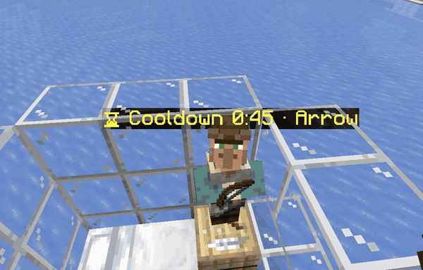

 

 

 

 

## ⚡ In one line

Trade a villager out of stock, and a **floating label** tells you *when it restocks* — or that it **never will**.

> Early development. Wording and behaviour may change.

## 🏷️ The labels

| Label | Means |
|---|---|
| 🟡 `⌛ Cooldown 4:47` | Game blocks restock for 4:47 more |
| 🔵 `☽ Off work 4:12` | Off shift. Restocks when work starts (8:00) |
| 🟠 `⚒ Needs work` | Wait is over. Villager must walk to its job block |
| 🔴 `✖ No workstation` | **Never restocks.** No job block claimed |
| 🟢 `✔ Ready` | Restocked. Trade away |

Each label also names the item that's sold out.

## 🎯 Why

Most villager packs remove trade limits. This one **keeps them**.

Stock, prices, demand, restock timing: all stay vanilla. It only fixes the missing feedback. The game says *sold out*, then goes quiet. Now you can see **when**, and **whether**.

> 🧭 An information tool, not a balance change.

## 📦 Install

1. Download the latest [release](../../releases), or copy the `villager_cooldown` folder
2. Drop it in `<world>/datapacks/`
3. Run `/reload` in game. A green `[VillagerCD] loaded` means it works

Remove it: run `/function villagercd:uninstall`, then delete the folder.

## ⏱️ How the countdown works

Restocking has no timer. A villager restocks by **working at its job block**, up to twice a day. The pack reads the game's own `LastRestock` and `RestocksToday`:

| `RestocksToday` | Blocked until |
|---|---|
| 0 | Not blocked (only the walk to the job block is left) |
| 1 | `LastRestock` + 2 min |
| 2 or more | `LastRestock` + 10 min |

Real game rules, not an invented timer. The pack **never modifies** trades or restocking.

## ⚠️ Limits

- The label **won't tick inside the trade screen**. Minecraft sends the title once. Close the screen to see it move
- Item names follow your game language. Modded items show the raw id
- With several locked trades, only the first is named
- Labels show only within **48 blocks** of a player

🔧 Under the hood

 

| File | Role |
|---|---|
| `tick_slow.mcfunction` | 1-second loop. Updates villagers near players, removes other labels |
| `tick_villager.mcfunction` | Per-villager entry. Resets state, dispatches |
| `check_slot.mcfunction` | Walks every trade slot |
| `update_display.mcfunction` | Computes the countdown, picks the label |
| `spawn_label.mcfunction` | Summons a `text_display` mounted on the villager |
| `set_text_*.mcfunction` | The label variants |

State lives in scoreboards keyed to each villager, so nothing is global and status survives reloads.

🇹🇭 สรุปภาษาไทย

 

Data pack สำหรับ Minecraft Java 26.1+ แสดงป้ายลอยเหนือหัว villager ที่ของหมด ว่าจะเติมของเมื่อไหร่ หรือจะไม่เติมเลย

- นับถอยหลังจากค่าจริงของเกม ไม่ไปแก้กลไกการเทรดเลย
- ไม่ใช่ pack เทรดไม่จำกัด ราคา limit และ demand ยังเป็น vanilla ทั้งหมด
- ไม่ต้องลง mod ถ้าเล่นเซิร์ฟเวอร์ ลงแค่ฝั่งเซิร์ฟเวอร์

| ป้าย | ความหมาย |
|---|---|
| 🟡 Cooldown | ติดคูลดาวน์ รอเวลา |
| 🔵 Off work | villager เลิกงาน รอถึงเวลางาน |
| 🟠 Needs work | หมดคูลดาวน์ รอเดินไป job block |
| 🔴 No workstation | ไม่มี job block จะไม่เติมของเลย |
| 🟢 Ready | เติมแล้ว เทรดได้ |

**ติดตั้ง**: วางโฟลเดอร์ `villager_cooldown` ใน `<เวิลด์>/datapacks/` แล้วพิมพ์ `/reload`

**ข้อจำกัด**: ตัวเลขไม่วิ่งในหน้าต่างเทรด ต้องปิดหน้าต่างถึงจะเห็น ป้ายแสดงเฉพาะ villager ในระยะ 48 บล็อก

## 📄 License

[CC BY-NC 4.0](LICENSE): free to use, study, modify and share, **but not to sell**. Credit the author.

© 2026 Thinnaphat
