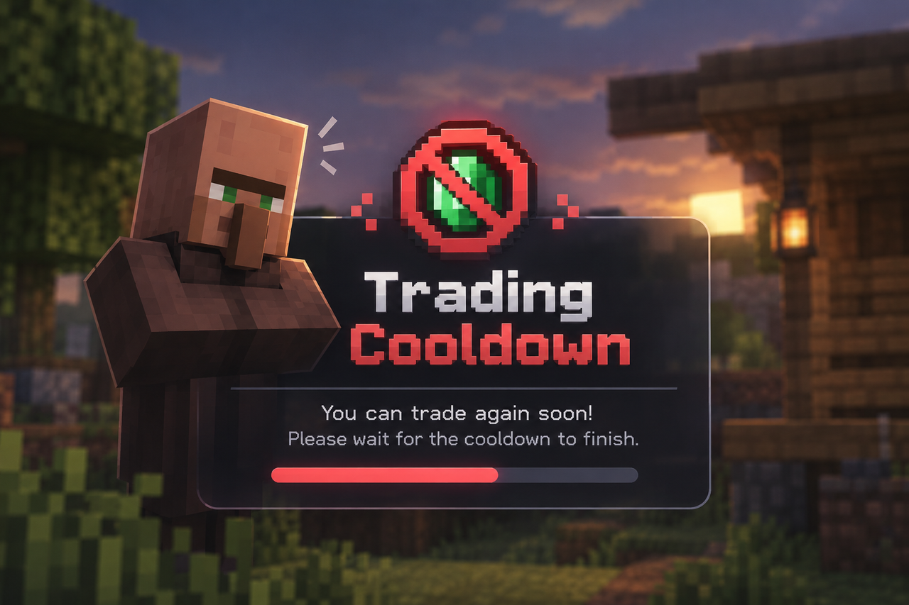

# Trading Cooldown

A vanilla Minecraft data pack that puts a live status label above every villager whose trades have sold out, so you can tell at a glance which one is worth walking to.

No mods. No client install. Works on servers — only the server needs it.

**Minecraft Java Edition 1.21+** (developed and tested on 26.2)

> **Early demo.** This is the first working release, published so people can look at it and try it. Expect wording, behaviour, and structure to change as development continues.

## What it does

Trade with a villager until an offer runs out of stock, and a floating label appears above its head telling you exactly what is holding it up:

| Label | Meaning |
|---|---|
| `Cooldowning: stick  4m 47s` | Locked. The game refuses to restock for another 4:47. |
| `Cooldowning: stick  (needs to work)` | Locked. The wait is over, but the villager still has to walk to its job block to restock. |
| `Cooldowning: stick  (no workstation!)` | Locked, and it will **never** restock — this villager has no job block claimed. |
| `Ready` | Restocked. You can trade again. |

The item name shown is the meaningful half of the trade: whichever side of the deal isn't emeralds.

## Why this exists

**This is not an infinite-trading data pack.**

Most data packs in this space solve villager trade limits by removing them — instant restocks, unlimited uses, no cooldown at all. That works, but it deletes the villager economy along with the inconvenience. Trade limits are a deliberate part of the game's balance, and once they are gone, emeralds stop meaning anything.

This pack is for players who want to keep that balance intact. Nothing here alters trading in any way: stock limits, restock timing, prices and demand all behave exactly as vanilla intends. Install it and the game plays the same as it did before.

What it fixes is not the mechanic — it is the missing feedback.

Vanilla tells you a trade is sold out, and then tells you nothing else. There is no indication of when that villager will restock, whether it is even able to restock, or whether standing around waiting will accomplish anything. So you guess. You come back too early, or too late, or you wait next to a villager that was never going to restock because it has no job block.

All of that information already exists inside the game. This pack simply surfaces it, one label at a time.

**In short:** this is an information tool, not a balance change. Your trades stay exactly as hard as Mojang made them — you just stop having to guess.

## How the countdown works

Minecraft does not expose a "time until restock" value, because restocking is not on a timer — a villager restocks by *working at its job site block*, up to twice a day.

What the game does track is `LastRestock` and `RestocksToday`, plus the rules that gate a restock:

- `RestocksToday = 0` → allowed immediately (only the trip to the workstation is left)
- `RestocksToday = 1` → blocked until `LastRestock + 2400` ticks (2 minutes)
- `RestocksToday ≥ 2` → blocked until `LastRestock + 12000` ticks (10 minutes)

This pack reads those fields and counts down to the moment the block lifts. The number is derived from the real mechanic, not an invented cooldown — and crucially, **the pack never modifies trades or restocking.** It only observes and reports.

## Install

1. Download the latest release, or copy the `villager_cooldown` folder from this repo
2. Drop it into `<your world>/datapacks/`
3. In game, run `/reload`
4. A green `[VillagerCD] loaded` confirms it

To remove it cleanly, run `/function villagercd:uninstall` first — this deletes the labels and scoreboards — then delete the folder.

## Known limitations

- **The label does not update inside the trade GUI.** Minecraft sends a container's title once when it opens and never refreshes it; there is no command that can change it mid-screen. Close the screen to watch the timer tick. (A client-side mod would be required to fix this.)
- Item names are shown as raw ids with the namespace stripped: `golden_carrot`, not `Golden Carrot`. Vanilla commands cannot transform strings beyond substrings.
- If several trades are locked at once, only the first one is named.
- Every villager in the world is scanned once per second. Very large trading halls may cost a little tick time.

## How it works internally

| File | Role |
|---|---|
| `tick_slow.mcfunction` | Self-rescheduling 1-second loop; also reaps orphaned labels |
| `tick_villager.mcfunction` | Per-villager entry; resets state and dispatches |
| `check_slot.mcfunction` | Recursive macro that walks every trade slot until it runs out |
| `update_display.mcfunction` | Computes the countdown and picks which label to show |
| `spawn_label.mcfunction` | Summons the `text_display` and mounts it on the villager |
| `set_text_*.mcfunction` | The four label variants |

State lives in scoreboards keyed to each villager entity, so nothing is stored globally and villagers keep their own status across reloads.

## License

[CC BY-NC 4.0](LICENSE) — free to use, study, modify and share, **but not to sell**.

Use it in your worlds and servers, take it apart to learn from, build your own version on top of it. Just credit the author and keep it out of anything people have to pay for. Full terms in [LICENSE](LICENSE).

© 2026 Thinnaphat

---

## สรุปภาษาไทย

Data pack สำหรับ Minecraft Java 1.21+ ที่แสดงป้ายลอยเหนือหัว villager ว่าของที่ขายหมดจะกลับมาเทรดได้เมื่อไหร่

- นับถอยหลังจากค่าจริงในเกม (`LastRestock` / `RestocksToday`) ไม่ใช่ตัวเลขที่ตั้งเอง
- ไม่ไปยุ่งกับกลไก restock ของเกมเลย แค่เฝ้าดูแล้วรายงาน
- ใช้ได้กับ vanilla ล้วน ไม่ต้องลง mod และถ้าเล่นในเซิร์ฟเวอร์ ลงแค่ฝั่งเซิร์ฟเวอร์พอ

**นี่ไม่ใช่ datapack สำหรับเทรดไม่จำกัด (Infinity Trade)**

datapack ส่วนใหญ่ที่แก้ปัญหาเรื่อง limit การเทรด มักใช้วิธีถอด limit ทิ้งไปเลย ซึ่งมันแก้ปัญหาได้จริง แต่ก็ทำลายระบบเศรษฐกิจของเกมไปด้วย พอเทรดได้ไม่จำกัด emerald ก็ไม่มีค่าอะไรอีกต่อไป

ตัวนี้ทำสำหรับคนที่อยากเก็บความสมดุลตรงนั้นไว้ — ไม่แตะกลไกการเทรดเลยแม้แต่นิดเดียว ทั้ง limit, เวลา restock, ราคา และ demand ยังทำงานตามที่เกมออกแบบมาทุกอย่าง

สิ่งที่มันแก้ไม่ใช่ตัวกลไก แต่คือ**ข้อมูลที่เกมไม่เคยบอกเรา** — vanilla บอกแค่ว่าของหมด แล้วก็เงียบ ไม่บอกว่าจะกลับมาเมื่อไหร่ ไม่บอกว่ามันจะกลับมาได้ไหม หรือรอไปก็เท่านั้นเพราะ villager ตัวนั้นไม่มีที่ทำงานตั้งแต่แรก เราเลยต้องเดาเอาเอง

ข้อมูลพวกนี้มีอยู่ในเกมอยู่แล้ว datapack นี้แค่เอามันขึ้นมาแสดงให้เห็น

**ติดตั้ง**: ก๊อปโฟลเดอร์ `villager_cooldown` ไปวางใน `<เวิลด์>/datapacks/` แล้วพิมพ์ `/reload` ในเกม

**ข้อจำกัดที่ควรรู้**: ตัวเลขในหน้าต่าง Trade จะไม่วิ่ง เพราะเกมส่งหัวข้อหน้าต่างให้แค่ตอนเปิดครั้งเดียว แก้ด้วย datapack ไม่ได้ ต้องปิดหน้าต่างถึงจะเห็นเวลาเดิน
